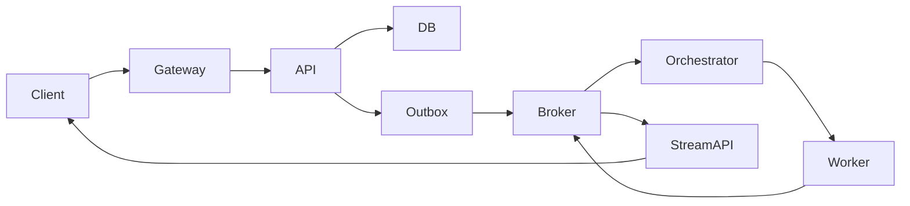

# 系统通信架构方案

> 状态：草案 / 已评审 / 已批准  
> 负责人：  
> 适用系统与版本：  
> 最后更新：

## 1. 结论摘要

- 对外控制面：
- 对外数据面：
- 对内协同：
- 投递语义：
- 恢复方式：
- 用户认证：
- 服务认证：
- 授权边界：
- 主要风险：

## 2. 场景、参与方和约束

| 项目 | 内容 |
|---|---|
| 参与方 | |
| 交互方向 | |
| 消息类型与频率 | |
| 峰值并发/连接数 | |
| 延迟预算 | |
| 可接受断线时长 | |
| 是否可丢/可重放 | |
| 顺序要求 | |
| 数据分级与租户边界 | |
| 部署与中间件约束 | |

假设与待确认项：

1.
2.

## 3. 端到端拓扑



说明同步边界、持久化点、重试点、取消点和超时。

## 4. 候选矩阵与选型

| 需求 | HTTPS/JSON | SSE | WebSocket | Webhook | gRPC | EventBus | Queue/Stream |
|---|---|---|---|---|---|---|---|
| 单向流式 | | | | | | | |
| 双向控制 | | | | | | | |
| 跨进程解耦 | | | | | | | |
| 重放/缓冲 | | | | | | | |
| 浏览器兼容 | | | | | | | |
| 运维成本 | | | | | | | |

选型结论：

- 选择：
- 不选择其他方案的原因：
- 重新评估触发条件：

## 5. 对外通道

逐个通道填写：

| 字段 | 内容 |
|---|---|
| 通道名称 | |
| 协议/端点 | |
| 方向 | |
| 认证与授权 | |
| 消息格式 | |
| 超时 | |
| 心跳 | |
| 重连退避 | |
| 游标/重放 | |
| 快照恢复 | |
| 服务端缓冲上限 | |
| 客户端缓冲上限 | |
| 慢消费者策略 | |
| 限流/配额 | |

SSE 必须说明：使用原生 EventSource 还是 fetch SSE、`Last-Event-ID`、保留窗口、心跳、代理缓冲验证和游标过期行为。

WebSocket 必须说明：握手认证、Origin、消息 ACK、重连、令牌过期、订阅授权、ping/pong 和背压。

## 6. 对内通道

| 主题/队列 | 生产者 | 消费者 | Key/顺序 | 投递语义 | 重试 | DLQ | 保留/重放 |
|---|---|---|---|---|---|---|---|
| | | | | | | | |

事务边界：

- Outbox：
- Inbox/幂等：
- 消费确认：
- 失败补偿：
- 人工重放与权限：

## 7. 事件与 API 契约

- OpenAPI：
- AsyncAPI：
- CloudEvents 版本：
- JSON Schema：
- 事件 ID：
- 幂等键：
- 关联字段：
- 版本兼容策略：

| 事件/端点 | 类型 | 必填字段 | 终态 | 错误码 | Schema |
|---|---|---|---|---|---|
| | | | | | |

## 8. 可靠性设计

### 8.1 外部连接状态机

```text
CONNECTING -> OPEN -> DEGRADED -> RECONNECTING -> CONNECTING
                              \-> COMPLETED
                              \-> TERMINAL
```

### 8.2 参数

| 参数 | 值 | 依据 |
|---|---|---|
| 心跳间隔 | | |
| 空闲超时 | | |
| 退避基数/上限 | | |
| 最大重试/停止条件 | | |
| 请求超时 | | |
| 服务端队列水位 | | |
| 客户端缓冲上限 | | |
| 重放保留期 | | |

### 8.3 重复、乱序、丢失与恢复

- 去重：
- 顺序：
- 断线重放：
- 游标过期：
- 快照：
- 重复副作用：
- 取消传播：

## 9. 认证与授权

| 项 | 方案 |
|---|---|
| 用户认证 | |
| API Token 校验 | |
| 会话/Cookie/CSRF | |
| SSE/WS 认证 | |
| 资源授权 | |
| 租户隔离 | |
| 服务认证 | |
| Agent 委托/工具权限 | |
| Webhook 验证 | |
| 密钥轮换 | |
| 审计 | |

必须说明令牌过期时如何关闭/刷新/重连，以及越权订阅如何拒绝。

## 10. 时序图

至少包含：

1. 正常创建与流式返回。
2. 断线重连与重放/快照。
3. 令牌过期或越权。
4. 重复投递、消费失败与 DLQ。
5. 取消或 HITL。

可直接改写 [sequence-diagrams.md](sequence-diagrams.md) 中的 Mermaid 模板。

## 11. 实施计划

| 阶段 | 代码落点 | 交付物 | 完成门槛 |
|---|---|---|---|
| 契约与 ADR | | | |
| 鉴权 | | | |
| 运行状态与 Outbox | | | |
| 内部执行 | | | |
| SSE/WS | | | |
| 客户端恢复 | | | |
| 可观测与压测 | | | |

固定生成顺序：

1. 共享类型与 Schema。
2. 认证/授权中间件。
3. 命令端点与事务边界。
4. Outbox/消费者/Inbox/DLQ。
5. 事件存储、游标与重放。
6. SSE/WS handler 与有界队列。
7. 客户端重连状态机与快照恢复。
8. 指标、告警和测试。

## 12. 验证与验收

| 场景 | 预期 | 自动化测试 | 结果 |
|---|---|---|---|
| 正常流 | | | |
| 断网 2 分钟 | | | |
| 代理缓冲 | | | |
| 游标过期 | | | |
| 令牌过期 | | | |
| 越权订阅 | | | |
| 重复投递 | | | |
| 消费重启 | | | |
| 乱序 | | | |
| 慢消费者 | | | |
| 取消重试 | | | |
| DLQ 重放 | | | |

压测指标：

- 峰值连接数：
- 重连风暴：
- 事件吞吐：
- 端到端延迟：
- 内存/队列上限：

## 13. 可观测性、发布与回滚

- 指标：
- Trace：
- 日志与脱敏：
- SLO：
- 告警：
- 灰度：
- 旧客户端/旧 Schema 兼容：
- 回滚：
- Kill switch：

## 14. 风险与未决项

| 风险/未决项 | 影响 | 负责人 | 截止时间 | 缓解措施 |
|---|---|---|---|---|
| | | | | |

## 15. 官方依据

列出实际使用的官方规范、版本与链接，并区分强制标准、最佳实践和厂商配置说明。

