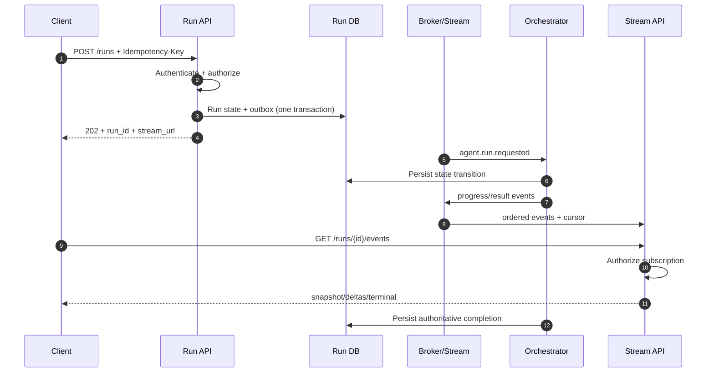
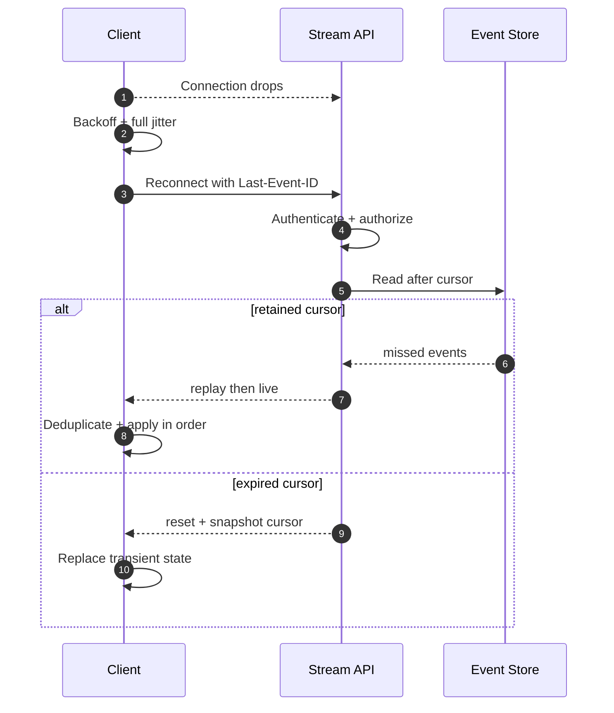
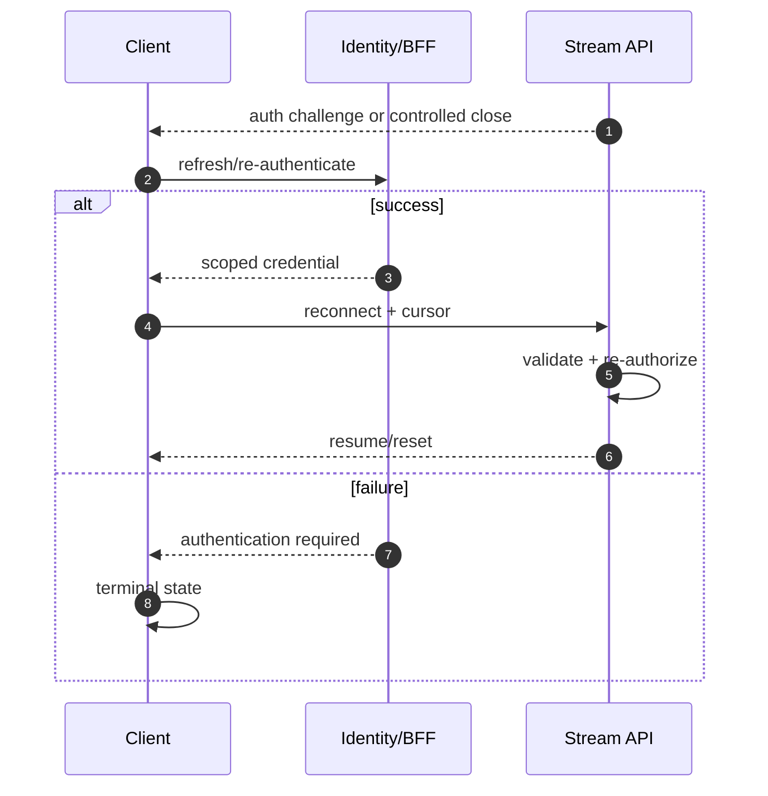
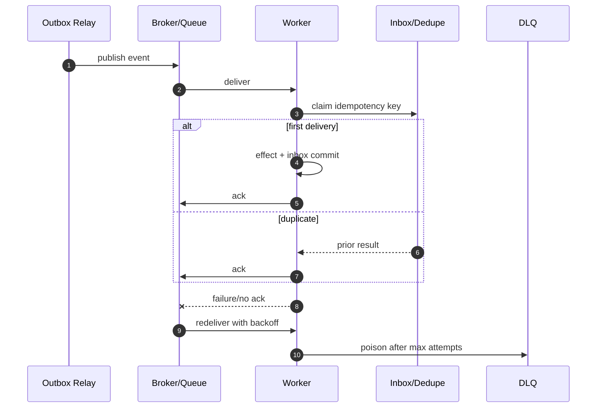
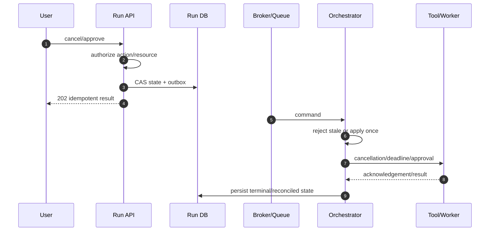

# Sequence Diagram Pack

Use or adapt these Mermaid diagrams in design documents and implementation PRs. Remove interactions that do not exist in the actual system.

## Normal Run and Stream

## SSE Reconnect, Replay, Snapshot

## Token Expiry

## Duplicate, Retry, DLQ

## Cancel or HITL

