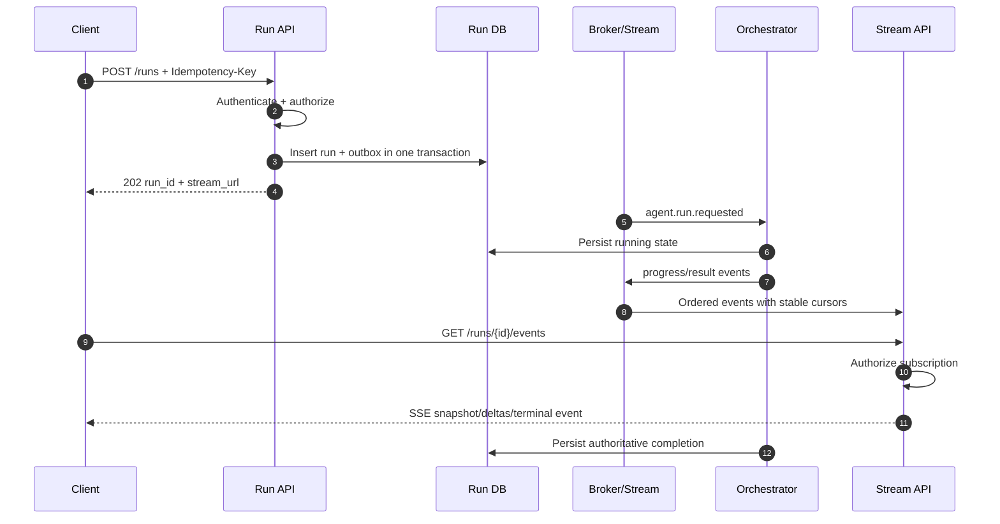
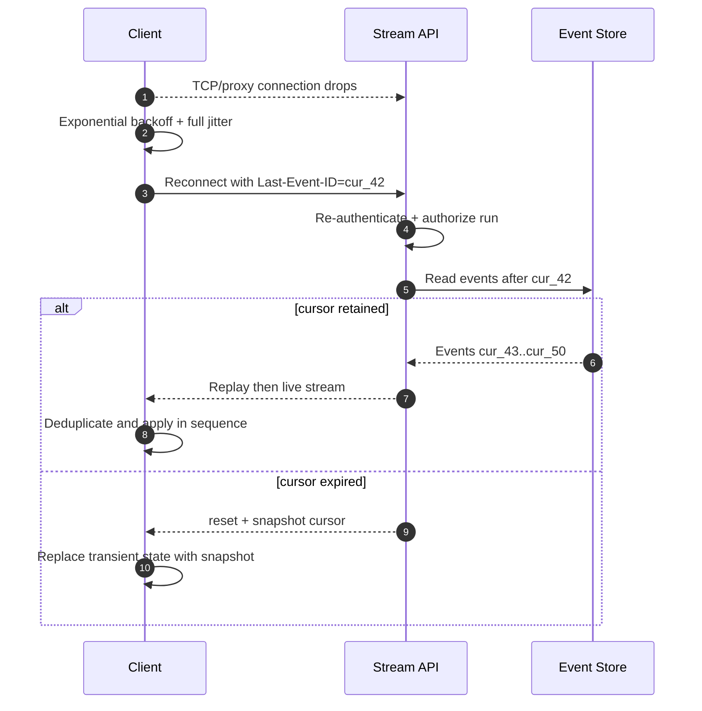
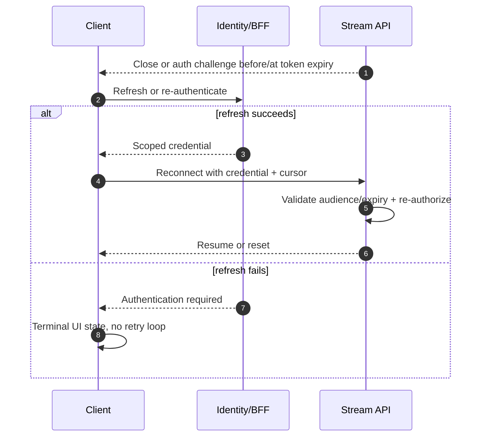
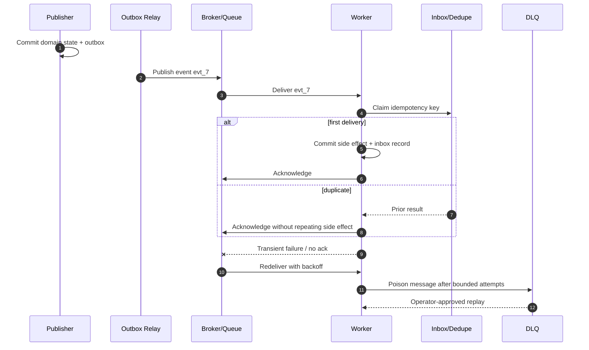
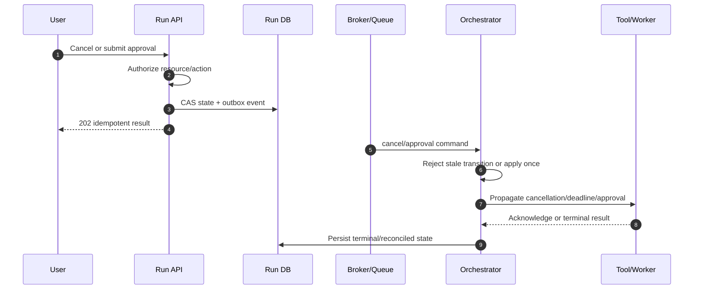

# Delivery Artifacts

Use this after the communication decisions are sufficiently stable. The purpose is to turn the design into reviewable diagrams, contracts, code, and tests without losing the decision rationale.

## Design-to-Code Gate

Before changing business code, write a compact decision summary:

- external control and data channels
- internal event/queue/stream choice
- delivery and ordering semantics
- cursor, replay, and snapshot strategy
- authentication, authorization, and delegation
- repository language/framework and target modules
- unresolved constraints that change the implementation

If the user asked for code directly, produce this summary first and proceed without waiting when the choices are clear.

## Required Diagrams

Use Mermaid `sequenceDiagram` unless the repository uses another diagram system. Keep participants at the architectural boundary level. Create only the diagrams that correspond to real risks, but normally include:

1. Normal run: create, persist, publish, execute, stream, complete.
2. SSE reconnect: disconnect, cursor, replay, dedupe, snapshot fallback.
3. Token expiry: reject, refresh/re-auth, reconnect, authorization re-check.
4. Internal duplicate/DLQ: outbox, redelivery, inbox dedupe, retry, DLQ, replay.
5. Cancellation or HITL: authorization, state transition, idempotent command, worker propagation.

Validate Mermaid syntax and participant names. Put diagrams next to the design that they explain; do not generate decorative diagrams for paths that were not designed.

## Contract Artifacts

Generate, according to stack:

- OpenAPI for synchronous HTTP endpoints and error responses.
- AsyncAPI for internal channels/topics and message bindings.
- JSON Schema for event payloads.
- CloudEvents examples for normal, duplicate, retry, failed, and terminal events.
- Webhook signature/replay examples where applicable.

Use one source of truth for generated types where practical. Keep hand-written domain types only when generated types would lose required invariants.

## Code Generation Order

1. Shared IDs, enums, error codes, event envelope, and schemas.
2. Auth middleware and resource policy hooks.
3. Run/command endpoint with idempotency and transaction boundary.
4. Outbox writer and publisher.
5. Consumer/inbox/dedupe/DLQ or equivalent.
6. Event persistence, cursor, replay, and snapshot service.
7. SSE server or WebSocket handler with bounded per-client queues.
8. Client parser, reconnect state machine, bounded buffer, dedupe, and snapshot recovery.
9. Observability and metrics.
10. Unit, contract, integration, failure, and load tests.

Use the repository's existing patterns first. Do not introduce a new broker, auth library, frontend state framework, or schema tool unless the current stack cannot satisfy the requirement.

## Sequence Diagram Templates

Adapt names and calls to the actual code; these are not mandatory exact interactions.

### Normal Run

### SSE Reconnect and Replay

### Token Expiry During a Long Stream

### Duplicate Delivery and DLQ

### Cancellation or HITL

## Code Review Checklist

- [ ] Protocol choice and rejection rationale match the design.
- [ ] Auth is enforced at endpoint and resource level.
- [ ] Stream and replay authorization use the same tenant/resource policy.
- [ ] Event IDs, cursors, sequences, and idempotency keys are stable and tested.
- [ ] Retry has backoff, jitter, stop conditions, and non-retryable statuses.
- [ ] Server and client buffers are bounded with explicit overflow behavior.
- [ ] Outbox/inbox/DLQ semantics are implemented, not merely documented.
- [ ] Token expiry and re-authentication are handled for long-lived connections.
- [ ] Metrics/traces connect HTTP, stream, broker, worker, and tool boundaries.
- [ ] Tests cover disconnect, duplicate, reorder, restart, expiry, slow consumer, and unauthorized subscription.

